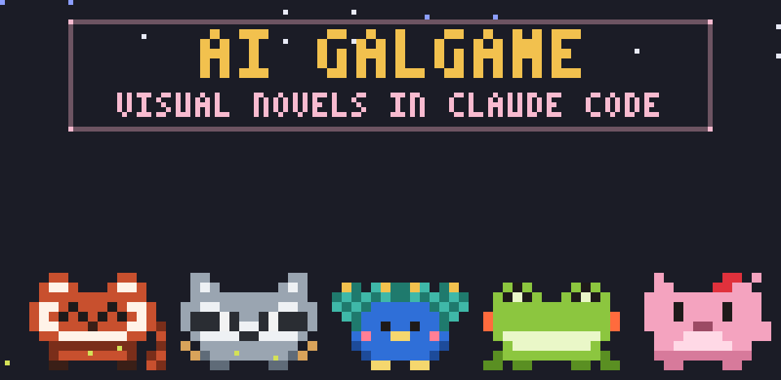
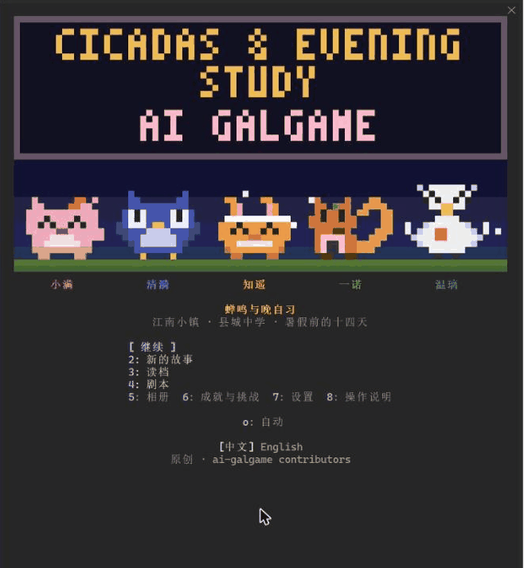

<div align="center">



# ai-galgame

**AI-native visual novels you play inside Claude Code.**
Humans write the story skeleton. Claude writes every scene live. You just press 1, 2, 3.

[](https://github.com/Ephemeral6/ai-galgame/stargazers)
[](LICENSE)
[](#install)
[](README.zh-CN.md)
[](#bundled-story-packs)
[](#license)

<!-- Main demo: record docs/demo.gif with demo/01-opening.tape, then add:
 -->

**English** · [中文](README.zh-CN.md)

</div>

### Quick start

```
/plugin install ai-galgame --marketplace Ephemeral6/ai-galgame
/gal
```

Press `1`–`9` to choose, `J` to continue, `O` to let Claude play for you.
Requires **Claude Code 2.1.287 or later** (mods). **No API key, nothing else to install.**

### Highlights

- **No setup.** Runs on your existing Claude Code account. No API key, no image model, no game engine, no extra downloads.
- **Every scene is written live.** Packs define characters, secrets, acts, key events and endings; the model writes each scene from that and from your past choices.
- **Let Claude play.** Press `O`: it picks places and choices and shows why, in dim text — *"→ Picked 2: I want to see whether she'll tell her secret."* Pauses after 6 scenes by default.
- **Characters remember.** Promises have deadlines; keep the key ones (★) to reach the true ending. On a second playthrough they half-remember you.
- **Looks good in a terminal.** Pixel animal sprites that blink, emote and turn away when shy; title cards, weather and fireflies, a pixel town map, a relationship web.
- **Play while you wait.** When Claude starts working the pane suggests a scene; when it finishes or needs your approval, the game pauses and tells you.
- **A real game shell.** Title screen, 3 save slots + autosave, undo, album, AI-drawn keepsakes, multiple endings, New Game+, achievements, a daily challenge and a spoiler-free ending card to share.
- **Make your own.** `/gal new <one-line idea>` writes a whole story pack; or write one by hand as a single JSON file. PRs welcome.
- **Cheap.** About one Sonnet + one Haiku call per scene. A full 42-scene run ≈ US$0.75–0.85 at list prices; the short pack ≈ $0.15. Haiku mode and a daily budget cap are in settings.

**Content.** No sexual content. The bundled stories are coming-of-age and slice-of-life; characters under 18 are never written into explicit scenes, and characters who aren't love interests (family, a rival, a con man) are marked so the AI never writes romance with them. New here? Start with **The Shelter Band & the River Fog Festival** — the narrator is 18, just out of school, filling in on bass for an underground band.

<!-- Second demo: record docs/autoplay.gif with demo/03-autoplay.tape, then add:
 -->

### How it compares

|  | ai-galgame | Ren'Py | AI-GAL / VinA (AI-generated games) | SillyTavern-style chat frontends |
| --- | --- | --- | --- | --- |
| Where you play | Claude Code side pane | Desktop app you build | A generated Ren'Py-style game | Browser |
| Who writes the story | Human skeleton + AI scenes | Human, line by line | AI from a prompt | Free-form chat |
| Input | Number keys only | Click | Click | Typing |
| Setup | One `/plugin install` | SDK + build | API key or local model + Stable Diffusion, plus Ren'Py (VinA) or GPT-SoVITS voices (AI-GAL) | Install + API key or local model |
| Plot structure | Acts, key events, promises and endings enforced by the engine | Fully scripted | Generated plot; branching varies by project | None by default |
| Art | Pixel sprites in the terminal | Any | AI images | Character cards |

(By category, from each project's README as of October 2026; corrections welcome.)

---

## Install

At the Claude Code prompt (Claude Code 2.1.287 or later):

```
/plugin install ai-galgame --marketplace Ephemeral6/ai-galgame
```

Answer `y` to *Add marketplace?* and keep the default user scope. Or from a shell: `claude plugin install ai-galgame --marketplace Ephemeral6/ai-galgame`. Then type **`/gal`**. With a wide terminal (about 110 columns or more) the pane opens beside the chat; on narrower ones it opens in the current view. Pixel art renders in the terminal; the desktop app and VS Code show a text version. Click the pane (or `ctrl+x`, then `tab`) to focus it before using the keys.

## How it plays

| Key | Does |
| --- | --- |
| `1`–`9` | choose an option or a place |
| `J` | next line / continue |
| `A` | show all lines |
| `U` | undo |
| `S` | save · load |
| `P` | album (memories, keepsakes, endings, promises, her diary, you in her eyes) |
| `R` | relationship web |
| `O` | autoplay on / off |
| `E` | settings (tabs `Z` display, `X` autoplay, `C` AI features, `V` cost, `N` work companion) |
| `X` / `M` / `C` | on the ending screen and in the album: export HTML / Markdown / ending card |
| `H` | help · `T` title · `B` back |

- **Pick where to go, and you pick who you meet.** Each day has a few time slots; everyone keeps a routine, and someone you've neglected may come looking for you. Fixed events lock the place on their day.
- **Acts and key events.** A pack splits its story into acts, each with key events — a twist, a misunderstanding, a secret coming out. When the people involved may be present, the engine has the AI write the event into that scene; past its deadline it happens anyway. Acts end on a cliffhanger, and after the common route the story locks onto one character's route or an ensemble route.
- **A supporting cast.** Teachers, deskmates, shopkeepers, coaches step in to move the plot. Relations between characters — old friends, rivals, misunderstandings, family — make the routes interweave.
- **Every run differs a little.** Rain, a blackout, exam results, bumping into someone: random incidents, seeded per run so undo and reload don't reshuffle them.
- **Every scene is written live.** Choices are *reply*, *observe* (a detail that pays off later) or *promise* (a commitment with a deadline). Promises made during key events are *key promises* (★).
- **Five relationship stages**, AI-drawn 8×8 pixel keepsakes, and true / good / normal / bad endings for each character; true endings may need a key promise kept, keepsakes collected, or a second playthrough.
- **Hand-written moments.** Packs can include set pieces whose core lines the author wrote; the AI keeps them word for word and writes around them.

**Looks.** Pixel-font title, day and ending cards with fade and wipe transitions; an ambient strip above the sprites (rain, snow, fireflies, cicada sound waves, lanterns, meteors, stars, mist) whose theme color follows the weather and time of day; emote bubbles, entrances and exits, stepping closer, turning away; name plates and choice cards with icons and color bars; a pixel town map when picking a place; a relationship web where a line that just changed flashes. At most 4 fps, repainting only what changed; it stops when the pane is hidden and can be turned off.

**AI director.** The same call that writes a scene also sets the weather, time of day, particles, a close-up object, a silent beat and stage directions; the engine performs them. No extra calls.

**AI-native.** Echoes of your previous playthrough; a message from her when you come back after more than 6 real hours; nightly offstage gossip between supporting characters; her diary — her side of the same day, often reframing what you thought happened; "you, in her eyes", built from the attitude of every choice you make, which characters call out; and a fourth card, "Let it be", where the AI chooses the way you usually would.

**Around your work.** Play while you wait (above). Coding events (off by default): passing or failing tests, a broken build or a `git commit` become story events — only the kind and outcome, never code, paths or output; a commit becomes a keepsake. A companion (off by default) in the status line comforts, cheers and reminds you to rest after two hours, at most twice an hour, from pre-written lines. Short scenes for a build break. Voice and sound effects (off by default), compact layout for narrow terminals, colorblind-friendly palette.

**Autoplay (`O`).** It picks places, who to go with and choices, showing its reason. Strategies: Devoted (one character, chosen by you or the AI), Whim (its own curiosity), Collector (new people, places and unseen endings first) and Chaos (random, no model calls). Pace slow / medium / fast; about 2 s on the choices so you can read them. It pauses after 6 scenes by default (3 / 12 / 24 or end of day), stops at an ending or on an error with the reason shown, and any other key pauses it. Autoplayed choices go into the album, can be undone, and unlock endings normally.

**Make, export, share.** `/gal new <idea>` generates a whole pack (3–5 min, progress in the status line, `K` cancels); `/gal repo` makes one from this project's README and manifest files after showing you exactly which files it will read (never source code, hidden files or secrets); `/gal export [html|md]` saves a run as a self-contained page or Markdown; `/gal card` gives the spoiler-free ending card; `/gal browse` installs community packs (original, CC0, CC BY, CC BY-SA only).

## Bundled story packs

| Pack | What it is | Size | License |
| --- | --- | --- | --- |
| **The Shelter Band & the River Fog Festival** | Original. A foggy southwestern river city, the summer after the college entrance exam; an underground band rehearsing in an old air-raid shelter, chasing the one newcomer slot at a festival. The narrator is 18. | 13 days × 3 slots · 4 romanceable + 5 supporting · 3 acts · 18 endings | CC BY 4.0 |
| **Cicadas & Evening Study** | Original flagship. A county-town high school, fourteen days before summer break: a club about to be cut, a race on a bad knee, a departure, a school paper and a student council. | 14 × 3 · 5 + 6 · 3 acts · 22 endings | CC BY 4.0 |
| **Last Train from Birch Ridge** | Original. A northeastern logging town, ten days before it empties. | 10 × 3 · 3 + 4 · 14 endings | CC BY 4.0 |
| **Seven Tides** | Original. A typhoon week that keeps repeating; you remember, up to two loops. | 7 × 3 · 3 + 3 · 14 endings | CC BY 4.0 |
| **Four Nights Before Sign-Off** | Original short. A school radio booth; a gentle fourth-wall story with an ending only on a second playthrough. | 4 × 2 · 1 + 2 · 6 endings | CC BY 4.0 |
| **Bridge to eQualia** (adaptation) | From Blackle Mori's work of the same name; trust, not romance. | 7 days · 4 + 3 · 12 endings | CC0 1.0 |
| **Little Mauve Riding Hood** (adaptation) | From *Le Petit Chaperon Mauve* by bosinpai et al.; a comic fairy-tale parody with no romance. | 4 days · 3 + 3 · 9 endings | CC BY-SA 4.0 |

Original packs borrow only the structure and mood of a genre; characters, plot, lines and names are original. Adaptations stay within the source's characters and setting and use only its text — no original art, music, sound or fonts. Each pack's folder has its sources, license and change list.

## Write your own pack

A pack is the skeleton of a story; every text field may be `{ "zh": "…", "en": "…" }`.

| Field | Required | What goes in it |
| --- | --- | --- |
| `cast` | yes | Romanceable characters (1–6): voice, sample lines, secret, five-stage beats, routines, deadline, pixel sprite; optional `tagline`; characters who aren't love interests take `romance: false` and `meter: { label, full, empty }` (the pane shows e.g. "Trust ●●○" instead of hearts and the AI never writes romance with them) |
| `places`, `slots`, `days`, `events`, `fixed` | yes | Places, time slots, days, calendar events, fixed events |
| `endings` | yes | Conditions (`minStage`, `minAffection`, `maxAffection`, `maxBroken`, `minBroken`, `minKept`, `keptKey`, `minKeepsakes`, `minLoop`, `flags`), `kind` (true / good / normal / bad), and one unconditional fallback |
| `npcs` | no | Supporting characters (0–8) with role, voice, samples, haunts, optional sprite |
| `relations` | no | `a`, `b` (cast, npc or `me`), `kind`, `text`; `hiddenUntil` keeps it a hint until a stage |
| `acts` | no | Acts with `from`, `title`, `goal`, key `beats` (`day`, `by`, `who`, `kind`, `text`, optional `slots` / `places` and key `promise`) and a `hook`; with acts, `chapters` may be omitted |
| `incidents` | no | Random or conditional events: `text`, `chance`, `days`, `slots`, `places`, `who`, `need`, `after`, `repeat` |
| `craft` | no | The writing layer: motifs, hand-written set pieces, common and character routes, reveals, daily texture, gags, gossip, character tics and diary voices — see [docs/NARRATIVE-CRAFT.md](docs/NARRATIVE-CRAFT.md) |

All optional fields can be left out; first-version packs run unchanged. Play locally with `/gal validate <path>` and `/gal import <path>` (or drop the JSON into `~/.claude/galgame-packs/`), let `/gal new` draft one for you, or contribute via a PR — see [CONTRIBUTING.md](CONTRIBUTING.md). Sprites are 14-column letter grids (`.` is transparent); the engine draws the eyes, blinks and small motions.

## AI cost

Everything runs on your Claude Code account.

- **Each scene**: one Sonnet call (choices carry their own reactions) plus one Haiku consistency check, with at most one rewrite — however many characters a pack has. Stage directions, atmosphere and choice tones ride in the same output.
- **Prompt caching**: premise, style, a one-line summary of everyone, the act outline, the writing guide and the output format are one cached block. With more than three characters, each scene carries full notes only for the people relevant to it.
- **Optional extras**, each switchable in settings: autoplay ≈ one Haiku call per decision (2–3 per scene, under US$0.001; none with Chaos); nightly gossip one Haiku call per story day (~US$0.0003); the away message at most once per return; her diary and "you in her eyes" only when you open them, then cached; "Let it be" once per use. Pack generation (`/gal new`, `/gal repo`) is 2–4 Sonnet calls, ~US$0.15–0.45, only when you ask.
- **Saving money**: use Haiku as the story model (~US$0.002 a scene instead of ~US$0.016–0.02) and set a daily budget; the header shows this run's and today's estimated cost.

| Pack | Scenes | Calls | Cost (approx.) |
| --- | --- | --- | --- |
| Cicadas & Evening Study | 42 | 95–110 (+ ~13 Haiku gossip) | US$0.75–0.85 |
| The Shelter Band & the River Fog Festival | 39 | 90–100 (+ ~12 Haiku gossip) | US$0.75 |
| Four Nights Before Sign-Off | 8 | ~20 | US$0.15 |

At Anthropic list prices (Sonnet $2 / $10 per million input / output tokens, cache reads $0.20; Haiku $0.10 / $0.50); your bill is what counts. The settings page shows actual calls, tokens and estimated cost. It won't slow Claude Code down: animation stays at 4 fps and repaints only what changed, drawing the pane never writes state, and autoplay steps on single timers.

## Development

```
claude --plugin-dir <this repo>      # load from source
claude plugin validate <this repo>   # manifest, hooks module, state contract
claude plugin test <this repo>       # tests/ with every model call mocked
```

Layout: `hooks/register.tsx` UI and state (migration, autoplay, play-while-you-wait, background jobs); `hooks/engine.ts` story engine; `hooks/craft.ts` writing layer; `hooks/fx.ts` pixel effects; `hooks/art.ts` sprites; `hooks/pilot.ts` autoplay decisions; `hooks/native.ts` AI-native extras; `hooks/work.ts` coding events and companion lines; `hooks/cost.ts` cost estimate; `hooks/feats.ts` achievements and daily challenge; `hooks/gen.ts` pack generation; `hooks/share.ts` export and ending card; `hooks/browse.ts` community; `hooks/pack.ts` validation; `hooks/i18n.ts` UI text; `assets/sfx/` sounds; `community/` index; `demo/` recording scripts; `packs/` story packs; `types/index.d.ts` types and state contract.

## License

Engine code (`hooks/`, `types/`, `tests/`, `packs/index.ts`) is **MIT** ([LICENSE](LICENSE)). Each story pack carries its own license (table above); `packs/mauve` is CC BY-SA 4.0 and adaptations of it must stay CC BY-SA 4.0. Please don't submit or distribute packs built from copyrighted commercial works — only original, CC0, CC BY or CC BY-SA material (no NC, ND or fan works). Import packs only if you have the right to use them.
